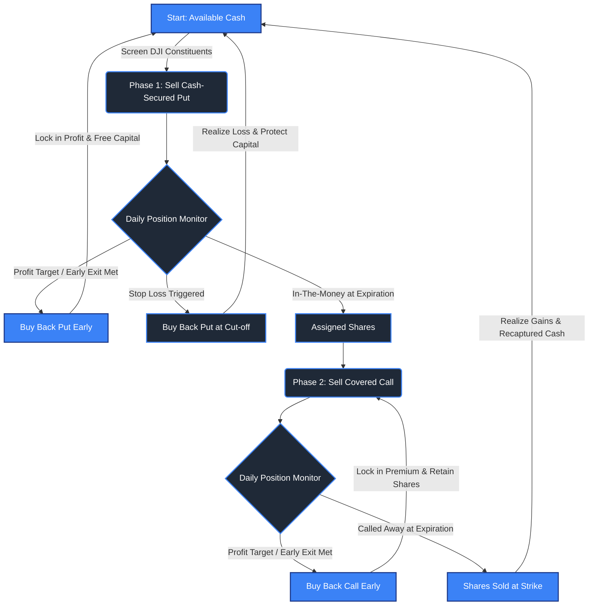

# The Algorithmic Wheel: DJI Implementation

A robust, systematic algorithm for harvesting option premiums across Dow Jones Industrial Average (DJI) constituents using the QuantConnect Lean platform. This project automates the classic "Wheel Strategy" (Cash-Secured Puts and Covered Calls) with strict quantitative risk management, dynamic Greek selection ($\Delta, \Theta$), and systematic early exit rules.

---

## Strategy Overview & Mechanics

The Wheel strategy is a multi-phase cyclic process designed to generate consistent income from option time decay ($\Theta$) while systematically acquiring and selling underlying equities. 

Unlike traditional passive options strategies that hold contracts until maturity, this implementation actively manages open holdings—buying back contracts prior to expiration upon hitting profit targets or risk thresholds.

### Conceptual Workflow: Dynamic Premium Cycle



---

## Key Features

- **Active Position Management:** Positions are monitored daily and bought back prior to expiration to optimize capital recycling and mitigate tail risk.
- **Dynamic Selection Engine:** Filters the 30 DJI constituents for liquidity, volatility, and oversold conditions before writing puts.
- **Greek & Strike Optimization:** Selects contracts based on target Delta ($\Delta$) ranges and Days to Expiration (DTE) window to maximize Theta ($\Theta$) decay.
- **Risk & Exposure Controls:** Manages portfolio collateral, limits single-ticker concentration, and enforces strict stop-loss rules on open positions.


---

## Project Structure

```text
├── main.py                # Main QuantConnect algorithm file
├── selection/             # Universe filtering & DJI constituent selector
├── execution/             # Order placement, limit orders, & buy-back logic
├── risk/                  # Position sizing, Delta limits, & stop-loss management
├── README.md              # Documentation & performance overview
└── config.json            # Parameters for DTE, Delta targets, & profit thresholds
```

---

## Getting Started

### Prerequisites
- [QuantConnect Lean CLI](https://www.quantconnect.com/docs/v2/lean-cli) or QuantConnect Web IDE.
- Python 3.8+

### Execution via LEAN CLI
To run a local backtest using LEAN CLI:

```bash
lean backtest "The Algorithmic Wheel"
```